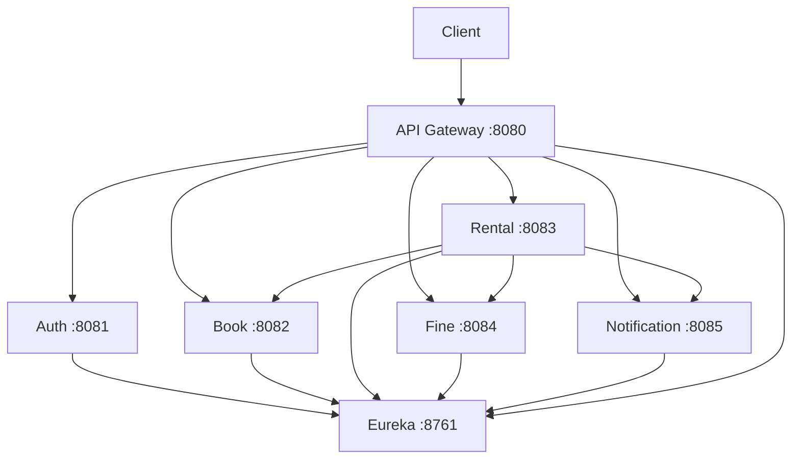

# Bibliotech Circulation Management Platform

Beginner-friendly Spring Boot microservices project for library cataloging, book lending, fines and stored notifications.

## Architecture



| Application | Port | Role |
|---|---:|---|
| eureka-server | 8761 | Discovery dashboard |
| api-gateway | 8080 | One public entry point |
| auth-service | 8081 | Register, login, JWT |
| book-service | 8082 | Inventory |
| rental-service | 8083 | Borrow/return workflow |
| fine-service | 8084 | Fine calculation |
| notification-service | 8085 | Stored console notifications |

## Setup and start order

1. Install Java 17 and Maven 3.9+. Create one MySQL database named `bibliotech`, then create a MySQL user and update `spring.datasource.username` and `spring.datasource.password` in each business service. All five business services use `jdbc:mysql://localhost:3306/bibliotech`; Hibernate manages each service's required tables with `spring.jpa.hibernate.ddl-auto=update`.
2. Use the **same** long `jwt.secret` in auth, book, rental, fine and notification properties. Change the example secret before a real deployment.
3. In separate terminals run `mvn spring-boot:run` in this order: `eureka-server`, `auth-service`, `book-service`, `fine-service`, `notification-service`, `rental-service`, then `api-gateway`.
4. Open `http://localhost:8761` and verify the five named services and gateway are registered.

## APIs through gateway

| Method | URL | Access |
|---|---|---|
| POST | `/auth/register` | public |
| POST | `/auth/login` | public |
| GET/PUT | `/auth/me` | JWT user/admin; current account only |
| POST | `/auth/change-password` | JWT user/admin; requires current password |
| GET | `/auth/users` | JWT admin only |
| GET | `/books` | JWT user/admin |
| POST/PUT/DELETE | `/books` | JWT admin |
| POST | `/rentals/borrow` | JWT user/admin |
| POST | `/rentals/return/{id}` | JWT user/admin |
| GET | `/rentals`, `/rentals/user/{userId}` | JWT user/admin |
| POST | `/books/{id}/availability?change={+1|-1}` | JWT admin |
| GET | `/fines/{rentalId}`, `/fines/user/{userId}`, `/fines/calculate` | JWT user/admin; owner or admin |
| GET | `/fines` | JWT admin only |
| GET/POST | `/notifications/user/{userId}`, `/notifications` | JWT user/admin |

Add `Authorization: Bearer <token>` to every protected request. The rental service forwards this header when it calls book, fine, and notification services via `RestTemplate` and Eureka names.

### Sample test payloads

Public registration creates a `USER` account; any submitted `role` is ignored. Use an already-provisioned `ADMIN` account for book administration. This API does not provide an admin-user provisioning endpoint. Login with `{"email":"reader@demo.com","password":"password123"}` and use the returned `token`, `role`, and `userId`.

Create a book: `{"title":"Clean Code","author":"Robert Martin","isbn":"9780132350884","category":"Programming","totalCopies":3,"availableCopies":3}`.

Borrow: `{"userId":1,"bookId":1,"loanDays":14}`. Return: `POST /rentals/return/1`.

Expected errors: missing/invalid token 401; a USER book mutation 403; unavailable copy 400; active duplicate rental 409; missing item 404.

## Frontend

The React/Vite client lives in `frontend/` and calls the gateway only. It uses the real book, rental, fine, notification, and auth routes listed above. The Auth Service returns profile data for the authenticated account, allows profile edits without changing account ID or role, and validates password changes against the existing encoded password. Fine and notification records are scoped to the signed-in member unless the caller is an administrator.

On Windows CMD, install and start it with:

```cmd
cd /d C:\Users\Swathi\OneDrive\Desktop\bibliotech-microservices\frontend
copy .env.example .env
npm install
npm run dev
```

Open `http://localhost:5173`. The gateway and microservices must already be running. To use a different gateway URL, set `VITE_API_BASE_URL` in `frontend/.env`. Do not put credentials or secrets in Vite environment variables.

The auth service now assigns `USER` to every public registration. New administrator accounts require a separate trusted provisioning process; existing `ADMIN` users can still sign in. The book service also restricts its availability-adjustment route to `ADMIN`.

## Swagger

Every business microservice exposes Swagger UI at `/swagger-ui.html` on its direct service port: 8081–8085. See [SWAGGER-TESTING.md](SWAGGER-TESTING.md) for the Review 1 sequence. Gateway routing is demonstrated through the gateway URLs above.

## Postman backup

Set `baseUrl=http://localhost:8080` and `token` variables. Login, set `token` to the response token, and use `Bearer {{token}}` on protected requests. First create ADMIN, then a USER, book, borrow, return, and inspect fine/notification endpoints.

## Common problems

* **Connection refused to MySQL** — start MySQL and correct its credentials in every properties file.
* **Services absent from Eureka** — start Eureka first and verify its URL is `http://localhost:8761/eureka/`.
* **401** — ensure all services share exactly the same JWT secret and paste only the token after `Bearer`.
* **403 adding a book** — login as an account registered with `role: ADMIN`.
* **No gateway route** — wait until the application appears on Eureka, then retry.
